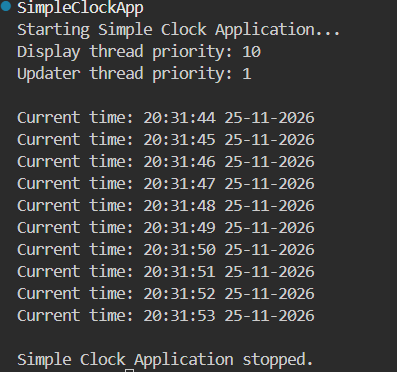
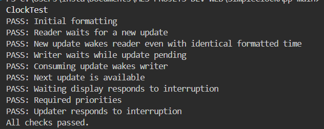

# SimpleClockApp

SimpleClockApp is a small Java console application that displays the current local time and date using two threads. I originally created it as part of a university assignment on multithreading.

The main purpose of this project is to explore how threads work, how they share information and how they can be stopped properly. I revisited the original version to improve thread synchronization, organize the source code and add automated tests.

## Features

- Displays the current local time and date in `HH:mm:ss dd-MM-yyyy` format.
- Updates the clock approximately once per second.
- Uses two worker threads: one to update the time and one to display it.
- Preserves the thread priorities required by the original assignment.
- Stops automatically after approximately 10 seconds and waits for both threads to finish.
- Includes nine automated checks for formatting, synchronization and thread interruption.

## Technologies used

- Java 21 (JDK)
- Java standard library (`java.time`, `Thread` and built-in synchronization)
- Git and GitHub for version control and project presentation

No external libraries or build tools are required.

## How it works

The application creates a shared `Clock` object and starts two worker threads:

| Thread | Priority | Responsibility |
| --- | --- | --- |
| `ClockUpdater` | 1 (minimum) | Retrieves and stores the current time. |
| `ClockDisplay` | 10 (maximum) | Waits for a new time value and prints it. |

The clock uses `synchronized`, `wait()` and `notifyAll()` to coordinate the two threads. The updater waits if the previous value has not been consumed, and the display waits when no new value is available. This follows a simple producer-consumer pattern.

Thread priorities are kept from the university assignment, but the application does not rely on them to guarantee execution order.

After approximately 10 seconds, the main thread interrupts both workers and uses `join()` to wait for them to finish before displaying the final message.

## Project structure

```text
SimpleClockApp/
├── src/
│   ├── Clock.java           # Shared time and synchronization
│   ├── ClockUpdater.java    # Time updates
│   ├── ClockDisplay.java    # Console output
│   └── SimpleClockApp.java  # Application entry point
├── tests/
│   └── ClockTest.java
├── screenshots/
│   ├── clock-running.png
│   └── test-results.png
├── .gitignore
└── README.md
```

## Getting started

Install JDK 21 and make sure `java` and `javac` are available in your terminal. Download or clone the repository, then open a terminal in the project directory.

Compile the application:

```bash
javac --release 21 -d build src/Clock.java src/ClockUpdater.java src/ClockDisplay.java src/SimpleClockApp.java
```

Run the application:

```bash
java -cp build SimpleClockApp
```

The clock starts immediately and stops automatically after approximately 10 seconds.

## Running the tests

Compile the source code and test class with compiler warnings enabled:

```bash
javac --release 21 -Xlint:all -Werror -d build src/Clock.java src/ClockUpdater.java src/ClockDisplay.java src/SimpleClockApp.java tests/ClockTest.java
```

Run the tests:

```bash
java -cp build ClockTest
```

The tests check the initial time format, waiting and notification between threads, preservation of thread priorities and interruption handling. A fixed time source is used to make formatting checks repeatable.

All nine checks passed during local testing, as shown in the screenshot below.

## Screenshots

### Clock running



### Automated tests



## Improvements from the original version

The original version used `volatile` to make changes to shared variables visible between threads. However, both workers slept independently, so the display could read the same update more than once or miss an update.

The revised version introduces condition-based synchronization so that the display consumes each pending update only once during normal operation. It also separates the four classes into individual files, simplifies cancellation through interruption, waits for worker termination using `join()`, and adds tests and a `.gitignore` file.

## Learning objectives

This project focuses on Java classes and objects, thread creation and priorities, shared state, the difference between memory visibility and synchronization, cooperative thread interruption and basic automated testing.

I kept the application small and console-based so that the main focus remains on understanding multithreading rather than building a complex interface.

## Limitations 

The clock is an educational project, not a precision timing tool. Updates may be delayed by thread scheduling or slow console output, and system clock changes may cause repeated or skipped displayed seconds. 

